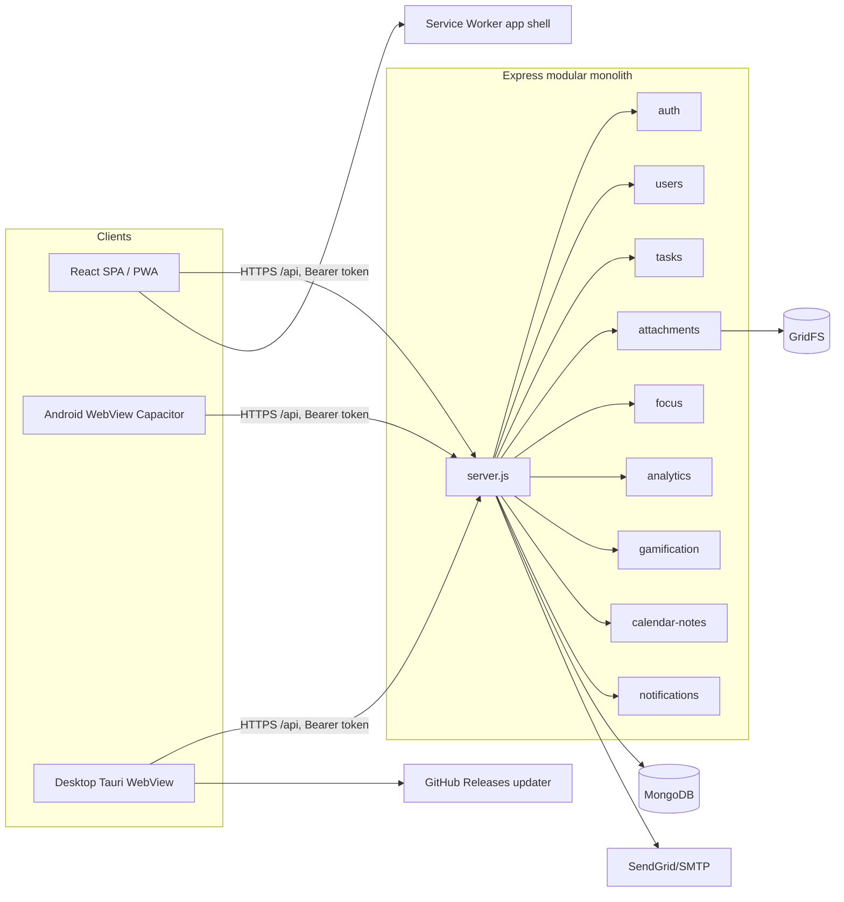
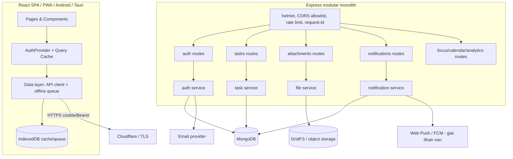

# PROJECT AUDIT — Kaito Todo App

> **Cập nhật trạng thái:** Tệp này đã tồn tại dưới dạng untracked trước khi lượt audit hiện tại bắt đầu. Snapshot cũ bên dưới mô tả trạng thái trước các thay đổi local. Addendum cuối tệp là nguồn đúng cho working tree hiện tại; không xóa snapshot cũ.

- **Repo**: `https://github.com/KaitoMuzic1413/Todo-App`
- **Workspace**: `/home/redhat/Documents/Backup/Documents/workPlace/mern-stack/Kaito-todo-app`
- **Nhánh / commit**: `todo-AI-v1.0.0` / `80bff6e fix 4.0.0` (snapshot baseline; xem addendum cho working tree hiện tại)
- **Ngày audit**: 2026-10-25
- **Phạm vi**: đọc mã nguồn backend, frontend, cấu hình deploy/desktop/Android; chạy test/lint/build. **Không** chạy server thật, không kết nối MongoDB, không test thủ công trên thiết bị, không penetration test.
- **Nguyên tắc**: không đọc giá trị bí mật trong `.env`; không sửa code trong lượt audit này; mọi kết luận có dẫn chứng `file:dòng` hoặc kết quả lệnh.

---

## 0. Kết luận điều hành

Đây là một **ứng dụng todo cá nhân khá hoàn chỉnh về tính năng** (task/note/list, lịch, focus timer, thống kê, thông báo, tệp đính kèm, PWA, Android, desktop), nhưng **chưa đạt mức production-ready cho nhiều người dùng thật**.

Chặn phát hành nghiêm trọng nhất:

1. `JWT_SECRET` có fallback hard-code `'SECRET_KEY'` ở cả ký và xác thực token.
2. Token truy cập lưu trong `localStorage` + không có refresh/revoke đầy đủ.
3. `/api/users/me` **không yêu cầu xác thực**, tra cứu người dùng bằng email và ghi đè `lastActiveAt`.
4. Đăng nhập phân biệt "tài khoản không tồn tại" (404) và "sai mật khẩu" (400) → liệt kê tài khoản.
5. Tệp SVG được cho phép và phục vụ `inline` → rủi ro stored XSS trên origin ứng dụng.
6. Không có rate limiting cho đăng nhập/OTP; CORS phản chiếu mọi origin.
7. **Test và lint đang đỏ**: backend 31/32, frontend 11/14, lint 7 error. Không có CI cho web/backend để chặn hồi quy.

Điểm mạnh: mô hình dữ liệu có index rõ ràng, phân quyền admin ở server, notification có idempotency, focus session chống trùng bằng `activeUserId` unique, trash có TTL 30 ngày, build frontend thành công, tài liệu đa nền tảng (`MULTIPLATFORM.md`) khá tốt.

---

## 1. Stack và kiến trúc hiện tại

### 1.1 Stack xác minh

| Lớp | Công nghệ |
|---|---|
| Frontend | React 19.2.8, Vite 6.4.3, React Router DOM 7.18.3, TanStack Query 5, Framer Motion 13, Tailwind CSS 4, shadcn/base-ui, Sonner |
| Backend | Node `>=24 <25` (máy audit đang chạy **22.22.1**), Express 4.18.2, Mongoose 9.9.1, MongoDB |
| Auth | JWT HS256 hạn 30 ngày, bcrypt cost 10, OTP reset qua email (HMAC-SHA256) |
| Tệp | multer `memoryStorage` 10 MB, GridFS |
| Email | SendGrid / Resend / SMTP qua nodemailer |
| Web/PWA | Service worker app-shell, manifest, Cloudflare static assets |
| Android | Capacitor 8, `com.kaito.todox`, versionName 3.1.0 |
| Desktop | Tauri 2, auto-update qua GitHub Releases |
| Deploy | Render (`todo-app-1112`, root `backend`) + Cloudflare (`frontend/dist`) + GitHub Actions (desktop) |

### 1.2 Sơ đồ hiện tại



### 1.3 Luồng chính

- **Auth**: `POST /api/auth/login` → JWT trong body → frontend lưu `localStorage.token` và `localStorage['todo-user']` (`frontend/src/lib/api.js:10-16`, `frontend/src/pages/Login/SignInPage.jsx:34-42`).
- **Mỗi request được xác thực**: `verifyToken` đọc Bearer, `jwt.verify`, tìm user, kiểm tra 30 ngày không hoạt động + `sessionVersion`, **ký lại token mới** và **ghi `lastActiveAt`** (`backend/src/middleware/authMiddleware.js:19-38`).
- **Task**: toàn bộ route `/api/tasks` đều qua `verifyToken`; controller luôn lấy `userId` từ token, **bỏ qua** `userId` client gửi lên (`backend/src/controllers/tasksControllers.js:16-19`, `:151-160`).
- **Calendar**: task theo khoảng thời gian + ghi chú theo `dateKey`; ghi chú unique theo `userId+dateKey`.
- **Focus**: một phiên active/người dùng nhờ index unique `activeUserId`; client poll 15 giây, Android đặt local notification chính xác.
- **Thông báo**: server cron 60 giây tạo notification đến hạn; client poll 60 giây, và `DueTaskReminderWatcher` poll task mỗi 60 giây để hiện Web Notification/toast.
- **Tệp**: upload vào GridFS trong RAM, tải xuống kiểm tra `ownerId`, preview `inline`.
- **Offline**: service worker chỉ cache app shell và asset; **không cache `/api/`**, không có IndexedDB hay queue đồng bộ (`frontend/public/sw.js:19-37`, `frontend/MULTIPLATFORM.md:9`).

### 1.4 Triển khai

- `render.yaml`: service `todo-app-1112`, `buildCommand: npm ci`, `startCommand: npm start`, health check `/`.
- `wrangler.jsonc`: SPA assets từ `./frontend/dist`.
- `.github/workflows/desktop-release.yml`: chỉ build desktop theo tag; **không có workflow test/lint/build cho backend/frontend**.
- Node 24 là yêu cầu trong `package.json` (`engines`) nhưng `render.yaml` không ghim phiên bản; máy audit đang dùng Node 22.

---

## 2. Mô hình dữ liệu

| Model | Trường chính | Ràng buộc / index đáng chú ý |
|---|---|---|
| `User` | email, password, name, lastActiveAt, sessionVersion, isAdmin, preferences, OTP reset, `premium.*` | email unique; OTP attempts; preferences enum |
| `Task` | userId, parentTaskId, title, contentType (`task/note/list`), content, items, status, startAt, dueAt, estimatedMinutes, timeZone, important, isDeleted, deletedAt | 5 index theo user/loại/thời gian; **TTL 30 ngày trên `deletedAt`** |
| `Attachment` | ownerId, taskId, fileId (GridFS), originalName, title, description, mimeType, size, pinned, important, isDeleted, deletedAt | `fileId` unique; index owner/createdAt; không có TTL |
| `CalendarNote` | userId, dateKey, content ≤ 4000 | unique `userId+dateKey` |
| `FocusSession` | userId, taskId, mode, status, duration/remaining/elapsed/actual, startedAt, endsAt | unique sparse `activeUserId`; index user/createdAt |
| `Notification` | title ≤120, content ≤5000, type, createdBy, targetType, targetId, requestId, fingerprint, seedKey | `requestId` unique sparse; enum type `welcome/system/update/task` |
| `NotificationRecipient` | notificationId, userId, isRead, readAt, deliveredAt | unique `notificationId+userId`; index user/unread |
| `GamificationEvent` | userId, taskId, eventType, idempotencyKey, xp, activityDate, weekStart | unique `userId+idempotencyKey` |

Ghi chú dữ liệu:

- `Task.deletedAt` vừa có TTL index (`backend/src/models/Task.js:91`) vừa có cron xoá thủ công (`tasksControllers.js:117-131`) — trùng chức năng, không sai nhưng dư thừa.
- `CalendarNote` chấp nhận `dateKey` một hoặc hai chữ số (`backend/src/controllers/calendarNotesController.js:3-8`), trong khi frontend luôn zero-pad (`frontend/src/lib/calendarUtils.js:23-28`). Vì unique index là theo chuỗi, `2026-9-5` và `2026-09-05` có thể cùng tồn tại cho một ngày.
- `User.premium` tồn tại nhưng chưa có luồng nghiệp vụ nào sử dụng.

---

## 3. API inventory (đã xác minh từ route)

Tất cả dưới `/api`.

| Nhóm | Endpoint | Bảo vệ |
|---|---|---|
| Auth | `POST /auth/register`, `/login`, `/forgot-password`, `/verify-reset-otp`, `/reset-password` | Công khai |
| Users | `GET /users/me` | **Không xác thực** |
| Users | `GET /users/current`, `GET/PATCH /users/preferences`, `PATCH /users/profile` | Bearer |
| Tasks | `GET /tasks`, `GET /tasks/calendar`, `POST /tasks`, `PUT /tasks/:id`, `PATCH /tasks/:id/toggle` | Bearer |
| Tasks | `GET /tasks/trash/all`, `DELETE /tasks/trash/clear`, `PATCH /tasks/:id/restore`, `DELETE /tasks/:id/permanent`, `DELETE /tasks/:id` | Bearer |
| Tasks | `GET /tasks/quota/:userId` | Bearer (tham số `userId` bị bỏ qua) |
| Attachments | `POST /attachments/upload`, `GET /attachments`, `GET /attachments/trash/all`, `DELETE /attachments/trash/clear`, `PATCH /attachments/:id`, `GET /attachments/:id/download`, `PATCH /attachments/:id/restore`, `DELETE /attachments/:id/permanent`, `DELETE /attachments/:id` | Bearer |
| Focus | `GET /focus/active`, `GET /focus/summary`, `POST /focus`, `PATCH /focus/:id/:action` | Bearer |
| Analytics | `GET /analytics` | Bearer |
| Gamification | `GET /gamification` | Bearer |
| Calendar notes | `GET /calendar-notes`, `PUT /calendar-notes/:dateKey` | Bearer |
| Notifications | `GET /notifications`, `GET /notifications/unread-count`, `PATCH /notifications/read-all`, `GET /notifications/:id`, `PATCH /notifications/:id/read` | Bearer |
| Notifications admin | `GET/POST /notifications/admin`, `DELETE /notifications/admin/:id` | Bearer + admin |
| Premium | `premiumRoutes.js` (invite create/redeem/list/delete) | **Không mount, controller không tồn tại** |

Lưu ý thứ tự route: `GET /tasks/quota/:userId` được khai báo sau các route tĩnh nên vẫn khớp; nhưng controller dùng `req.user.userId`, không dùng `:userId` (`tasksControllers.js:213-222`) → tham số gây hiểu nhầm, **không phải IDOR** ở phiên bản hiện tại.

---

## 4. Trạng thái tính năng

| Tính năng | Trạng thái | Bằng chứng / ghi chú |
|---|---|---|
| Đăng ký / đăng nhập email | Có | `authControllers.js`; chưa xác minh email |
| Quên mật khẩu OTP | Có | OTP HMAC, hết hạn, tối đa 5 lần thử (`authControllers.js:134-157`) |
| Task / note / list | Có | `Task.contentType`; `HomePage` nhận `contentType` |
| Subtask | Một phần | Model có `parentTaskId`, không thấy UI subtask chuyên biệt |
| Lịch ngày/tuần/tháng + ghi chú | Có | `CalendarPage.jsx`, `calendarUtils.js`, `calendarNotesController.js` |
| Cảnh báo trùng lịch / quá tải | Có | `getDayWarnings` (`calendarUtils.js:68-103`) |
| Focus timer + pause/resume/complete/cancel | Có | `FocusPage.jsx`, `focusControllers.js` |
| Báo thức focus trên Android | Có | `focusNotifications.js:42-76`, plugin khai báo `POST_NOTIFICATIONS`, `SCHEDULE_EXACT_ALARM`, `RECEIVE_BOOT_COMPLETED` (manifest merger) |
| Dashboard năng suất | Có | `DashboardPage.jsx`, `/analytics` |
| Gamification XP/mục tiêu | Có (backend + tóm tắt ở Home) | `gamification.js`, `HomePage.jsx:57` |
| Thông báo trong app | Có | `NotificationCenter.jsx`, poll 60 giây |
| Thông báo admin | Có | `AdminNotificationsPage.jsx`; idempotency key |
| Nhắc task đến hạn khi app mở | Có | `DueTaskReminderWatcher.jsx` poll 60 giây |
| Nhắc task đến hạn khi app đóng | **Không đảm bảo** | Phụ thuộc Web Notification/OS; email do server cron gửi |
| Tệp đính kèm + preview + trash | Có | `ArchivePage.jsx`, `TrashPage.jsx`, GridFS |
| Trash task/tệp + TTL 30 ngày | Có | TTL + cron |
| Archive task đã hoàn thành | **Không** | `/archive` là kho tệp, không phải task archive |
| Settings theme/accent/ngôn ngữ/tên | Có | `SettingsPage.jsx` |
| Tải desktop Windows/Linux | Có | GitHub Releases + `DesktopAppDownloads.jsx` |
| Tải Android từ web | **Không** | `DownloadPage.jsx:8` chỉ nhận `windows/linux`; component không có card Android dù Settings phát hiện `android` (`SettingsPage.jsx:19-26`, `DesktopAppDownloads.jsx:98-99,144-145`) |
| PWA install/update | Có, giới hạn | Shell-only, không offline dữ liệu (`sw.js`) |
| Desktop auto-update | Có | `App.jsx:106-127`, workflow release |
| Premium/quota | **Chỉ scaffold** | `User.premium`, `premiumRoutes.js`, `ui/sidebar.jsx` link `/premium` không có route; quota trả `Infinity` cho mọi user |
| Offline-first | **Không** | Không có IndexedDB/queue |
| CI test/lint/build | **Không** | Chỉ workflow desktop |
| Observability | **Không** | Chỉ `console.*` |

---

## 5. Kết quả kiểm chứng

### 5.1 Lệnh đã chạy

| Lệnh | Kết quả |
|---|---|
| `cd backend && npm test` | **32 test, 31 pass, 1 fail** |
| `cd frontend && npm test` | **14 test, 11 pass, 3 fail** |
| `cd frontend && npm run lint` | **7 error, 2 warning** |
| `cd frontend && npm run build` | **Thành công** (2491 module; main 236 kB / 58 kB gzip; vendor 517 kB / 166 kB gzip) |
| `node --check backend/src/server.js` | Hợp lệ |
| `git status --short` | Sạch, không có thay đổi |

### 5.2 Test fail

1. Backend — `backend/test/notifications.test.js:7`: test tạo notification `type: 'reminder'`, nhưng enum model chỉ có `welcome/system/update/task` (`backend/src/models/Notification.js:6`). Đây là **lệch hợp đồng test–model**; cần xác nhận `reminder` là tính năng bị bỏ hay test cũ.
2. Frontend — `frontend/test/calendarUtils.test.js:5,12,19`: test kỳ vọng `dateKey` không zero-pad (`2026-9-5`), implementation zero-pad (`2026-10-05`). Test cũ so với implementation hiện tại.

### 5.3 Lint error

- `src/components/ui/card.jsx:1` — `React` không dùng.
- `src/hooks/use-mobile.js:14`, `src/hooks/useSwiftSidebar.js:73` — `setState` đồng bộ trong effect (rule React mới).
- `src/pages/Login/ForgotPasswordPage.jsx:183` — gọi `Date.now()` khi render.
- `src/pages/TrashPage.jsx:20` — `getAttachmentType` không dùng.
- `tailwind.config.js:1`, `vite.config.js:10` — ESLint chỉ khai báo browser globals (`eslint.config.js:17`) nên báo `module`/`process` là undefined. Đây là **lỗi cấu hình lint**, không phải lỗi runtime.

### 5.4 Chưa kiểm chứng

- Chạy server với MongoDB thật; migration/index thực tế trên Atlas.
- Build Android (`./gradlew`), cài trên thiết bị, hành vi notification khi app bị kill.
- Build Tauri, auto-update, ký số.
- Hành vi CORS/rate limit dưới tải; quét bảo mật tự động.
- Chạy trên Node 24 (máy audit chỉ có Node 22).

---

## 6. Phát hiện theo mức độ

### P0 — Chặn production

#### P0-1. Fallback JWT secret hard-code

- Bằng chứng: `backend/src/controllers/authControllers.js:8`, `backend/src/middleware/authMiddleware.js:12,30`; OTP HMAC cũng dùng secret này (`authControllers.js:138,197`).
- Tác động: nếu quên đặt `JWT_SECRET`, kẻ tấn công biết secret mặc định có thể ký token tùy ý và giả mạo OTP.
- Hướng sửa: validate env lúc khởi động, từ chối chạy nếu thiếu hoặc < 32 ký tự; xóa toàn bộ fallback; tách secret OTP riêng.
- Hoàn tất khi: grep không còn `'SECRET_KEY'`; app fail-fast khi thiếu env; có test.

#### P0-2. Token trong `localStorage`, thiếu vòng đời/refresh chuẩn

- Bằng chứng: `frontend/src/lib/api.js:10-16`, `SignInPage.jsx:40-42`, `LayoutShell.jsx:245`; server ký lại token mỗi request (`authMiddleware.js:28-33`).
- Tác động: bất kỳ XSS nào cũng lấy được token 30 ngày; không có refresh token/rotation; logout chỉ xóa client.
- Hướng sửa: chuyển sang cookie `HttpOnly; Secure; SameSite=Lax` (kèm CSRF) hoặc access token ngắn hạn + refresh token; tăng `sessionVersion` khi logout toàn bộ; không trả token trong body nếu dùng cookie.
- Hoàn tất khi: token không đọc được bằng JS; logout thu hồi được ở server; có test hết hạn/thu hồi.

#### P0-3. `/api/users/me` công khai + liệt kê tài khoản khi login

- Bằng chứng: `backend/src/routes/usersRoutes.js:7` (không `verifyToken`), `usersControllers.js:210-230` (nhận `email`, trả `_id/email/name/lastActiveAt`, ghi `lastActiveAt`); login trả 404 vs 400 (`authControllers.js:93,102`).
- Tác động: xác nhận email tồn tại, lộ tên/hoạt động, và có thể "đánh thức" tài khoản khiến cron xoá tài khoản không hoạt động bỏ qua.
- Hướng sửa: xóa endpoint `/me` (frontend dùng `/current`), hoặc bắt buộc auth và bỏ query email; login luôn trả 401 thông điệp chung; cân nhắc bỏ "account has no password" để tránh lộ.
- Hoàn tất khi: không thể tra cứu user bằng email; login không phân biệt nguyên nhân.

#### P0-4. Stored XSS qua SVG + preview inline

- Bằng chứng: allowlist có `svg+xml` (`attachmentsControllers.js:6`), fallback theo đuôi file (`:87-91`), tải về đặt `Content-Disposition: inline` khi `preview=true` (`:250-252`), không đặt `X-Content-Type-Options: nosniff`.
- Tác động: SVG chứa script chạy trên origin API khi người dùng mở preview; có thể đánh cắp token trong `localStorage`.
- Hướng sửa: chặn SVG (hoặc chỉ cho tải về dạng `attachment` + `Content-Security-Policy: sandbox`), kiểm tra magic bytes, sanitize filename, thêm `nosniff`, `Content-Disposition` an toàn (RFC 5987).
- Hoàn tất khi: SVG không render inline; header an toàn; có test upload SVG/HTML giả MIME.

#### P0-5. Không có rate limiting; CORS phản chiếu mọi origin

- Bằng chứng: `backend/src/server.js:25-33` (`origin: true`), không có `express-rate-limit` trong dependencies; auth cho phép thử mật khẩu/OTP không giới hạn theo IP.
- Tác động: brute force, email bombing OTP, lạm dụng API; CORS rộng làm giảm lớp phòng thủ (dù token nằm ở header).
- Hướng sửa: `express-rate-limit` cho `/auth/*` và toàn API; allowlist origin từ `FRONTEND_URL` + domain phụ; khóa tạm theo email/IP sau N lần sai; giữ OTP attempt cap hiện có.
- Hoàn tất khi: 429 sau ngưỡng; CORS chỉ chấp nhận origin cấu hình.

#### P0-6. Test/lint đỏ, không có CI cổng chất lượng

- Bằng chứng: mục 5; `.github/workflows` chỉ có `desktop-release.yml`.
- Tác động: hồi quy lọt vào nhánh chính; không ai biết build/test có xanh.
- Hướng sửa: sửa 3 test lệch hợp đồng (quyết định format `dateKey`/enum `reminder`), sửa 7 lint error hoặc cấu hình loại trừ hợp lý cho file config; thêm workflow `ci.yml` chạy backend test + frontend lint/test/build trên PR.
- Hoàn tất khi: 3 lệnh xanh trên CI; nhánh bảo vệ bắt buộc.

### P1 — Nên sửa trước khi mở cho người dùng ngoài

1. **Xác thực & phiên**
   - `verifyToken` ghi DB + ký token mỗi request (`authMiddleware.js:28-38`) → 2 thao tác DB/request; nên throttle cập nhật `lastActiveAt` (ví dụ 5 phút) và bỏ ký lại mỗi request.
   - `connectDB()` được gọi lại mỗi request (`server.js:37-45`, `config/db.js:3-13`) và `process.exit(1)` nếu lỗi → rủi ro kill process; chỉ nên kết nối một lần + health check.
   - `bcrypt` cost 10; chính sách mật khẩu chỉ chữ + số 8–20, cấm ký tự đặc biệt (`authControllers.js:30`, `SignUpPage.jsx:20`) → giảm entropy. Đề xuất tối thiểu 12 ký tự, cho phép ký tự đặc biệt, cost 12.
   - Không có xác minh email khi đăng ký; OTP chỉ dùng reset.
2. **Nhất quán state frontend**
   - User được đọc/ghi rải rác qua `localStorage` và event `todo-auth-changed` (`LayoutShell`, `SettingsPage`, `TrashPage`, `FocusPage`, `DueTaskReminderWatcher`); dễ lệch trạng thái. Đề xuất `AuthProvider` + TanStack Query làm nguồn sự thật.
   - ProtectedRoute chỉ kiểm tra sự tồn tại của user/token trong localStorage (`App.jsx:36-54`), không kiểm tra hạn token; 401 interceptor xóa storage nhưng không điều hướng (`api.js:24-31`), có thể đứng ở trang trống.
3. **Polling quá dày**
   - `HomePage` refetch 3 giây cả khi tab ẩn (`HomePage.jsx:98-99`), notification 60 giây, due-task 60 giây, focus 15 giây. Đề xuất giảm, dùng `refetchIntervalInBackground: false`, hoặc SSE/WebSocket cho notification.
4. **Offline/reminder**
   - Không có hàng đợi offline; thao tác khi mất mạng thất bại im lặng (nhiều nơi chỉ `console.error`).
   - Nhắc việc khi app đóng không đảm bảo trên web/iOS; Android chỉ có báo thức focus, không có local notification cho task due.
5. **Attachment**
   - Không kiểm tra quota/dung lượng phía server; mọi user coi như không giới hạn (`getUserQuota` trả `Infinity`).
   - Buffer 10 MB trong RAM; chưa quét virus/magic bytes; filename trong header chưa chuẩn hóa triệt để.
6. **Dữ liệu lớn**
   - `GET /tasks`, `GET /attachments` trả toàn bộ bản ghi, không phân trang server; client tự lọc/phân trang (`ArchivePage`, `TrashPage`).
7. **Premium dở dang**
   - `premiumRoutes.js` import controller không tồn tại, không mount; `ui/sidebar.jsx` có link `/premium` nhưng không có route; `User.premium` không được dùng. Cần quyết định: hoàn thiện hoặc xóa.
8. **Môi trường**
   - Repo yêu cầu Node 24 nhưng `render.yaml` không ghim; máy dev đang 22. Thêm `.nvmrc`, `engines` nhất quán, CI Node 24.

### P2 — Chất lượng, hiệu năng, bảo trì

- **Dead code/broken code**: `backend/src/socket.js` (CommonJS `require` trong package ESM, không được import), `frontend/src/socket.js` (tạo kết nối tới server không có socket.io), `frontend/src/api/{axiosClient,taskApi}.js` (không dùng; `taskApi` gọi `/tasks/quota` thiếu `:userId` → 404), `frontend/src/lib/axios.js` (không dùng), `ui/sidebar.jsx` (ví dụ Premium không dùng), `ResetPasswordPage` chỉ redirect.
- **Root `package.json`** khai báo `framer-motion` và `@tanstack/react-query` không dùng ở root.
- **Bundle**: vendor 517 kB (166 kB gzip); `chunkSizeWarningLimit: 5000` che cảnh báo; nên lazy-load route (Calendar, Dashboard, Archive, Admin).
- **Accessibility**: `NotificationCenter` có focus trap; các modal ở Archive/Trash/Admin chưa có focus trap/khôi phục focus đầy đủ; chặn context menu và phím devtools (`App.jsx:129-150`) gây khó chịu, không phải bảo mật.
- **i18n**: một file 787 dòng; nhiều chỗ dùng `t.key || 'fallback'`; chưa có kiểm tra parity en/vi tự động.
- **Ngày/giờ**: phụ thuộc timezone trình duyệt; test calendar nhạy timezone; `dateKey` không thống nhất định dạng.
- **Tài liệu**: `frontend/README.md` vẫn là template Vite; `MULTIPLATFORM.md` tốt nhưng chưa mô tả API/kiến trúc.
- **Không có logging có cấu trúc/request id/metrics/alerting.**

### P3 — Cải tiến dài hạn

- TypeScript hoặc JSDoc + validation schema (zod) cho body/query.
- OpenAPI/Swagger và client types tự sinh.
- E2E Playwright (web) + smoke test Android (Maestro/Detox).
- Data export/delete theo yêu cầu người dùng; chính sách lưu trữ 30 ngày đã có.
- Tối ưu ảnh/icon, virtual list cho task lớn.
- Tách `monorepo` bằng npm workspaces, bỏ dependency trùng.

---

## 7. Kiến trúc đề xuất

### 7.1 Nguyên tắc

1. **Giữ modular monolith** (Express + MongoDB) — phù hợp quy mô hiện tại, không cần microservice.
2. **Tách lớp rõ ràng**: route → middleware (auth/validate/rate-limit) → service → repository/model. Controller hiện đang gánh quá nhiều nghiệp vụ.
3. **Một nguồn sự thật cho auth ở client**; server là nguồn sự thật cho dữ liệu.
4. **An toàn mặc định**: fail-fast env, cookie HttpOnly, allowlist CORS, validate input, giới hạn tần suất.
5. **Offline có kiểm soát**: cache đọc + queue ghi cho task, không hứa hẹn đồng bộ tuyệt đối.

### 7.2 Sơ đồ mục tiêu



### 7.3 Thay đổi kiến trúc cụ thể

- **Auth**: cookie HttpOnly + CSRF token; access token ngắn hạn nếu cần mobile; `sessionVersion` dùng để revoke; bỏ ký lại token mỗi request; throttle `lastActiveAt`.
- **Validation**: zod/joi cho mọi body/query/params; chuẩn hóa lỗi `{ code, message, details }`.
- **Files**: object storage (S3/R2) thay GridFS khi có nhiều người dùng; nếu giữ GridFS, thêm quota + magic-byte + antivirus + header an toàn.
- **Notifications**: giữ in-app DB, thêm Web Push/FCM ở P2; server cron hiện tại ổn cho email.
- **Offline**: queue mutation (create/update/toggle/delete) + version/updatedAt để phát hiện xung đột; cache đọc theo query key.
- **Observability**: pino + request-id + `/healthz` (DB ping) + Sentry; log JSON.
- **CI/CD**: pipeline test/lint/build cho PR; deploy backend qua Render, frontend qua Cloudflare; migration/index kiểm soát bằng script.

---

## 8. Roadmap P0–P4

### P0 — Ổn định bảo mật tối thiểu (0–2 ngày)

| Việc | Hoàn tất khi |
|---|---|
| Fail-fast env (`JWT_SECRET`, `MONGODB_CONNECTIONSTRING`, `FRONTEND_URL`) | Thiếu env → process dừng với thông báo rõ; không còn fallback |
| Xóa/khóa `/api/users/me`; login trả lỗi chung | Không tra cứu được email; không phân biệt tài khoản |
| Rate limit auth + OTP; giữ OTP attempt cap | 429 sau ngưỡng; test brute force |
| CORS allowlist | Origin lạ bị từ chối |
| Chặn SVG inline; thêm `nosniff` + CSP sandbox cho download | Upload SVG không render; header đúng |
| Sửa test/lint; thêm CI | `backend npm test`, `frontend lint/test/build` xanh trên CI |

### P1 — Xác thực, dữ liệu, vận hành (1–2 tuần)

- Cookie HttpOnly/refresh hoặc access ngắn hạn; logout revoke server.
- AuthProvider + React Query; bỏ đọc/ghi `localStorage` rải rác.
- Giảm polling; tắt refetch khi tab ẩn.
- Sửa lệch hợp đồng `dateKey`/`reminder`; thêm test API với MongoDB memory server.
- Xóa dead code (premium/socket/api cũ/sidebar mẫu) hoặc hoàn thiện premium có kiểm soát.
- Ghim Node 24 (.nvmrc, render, CI); thêm health check DB.
- Chuẩn hóa lỗi API + validate input.

### P2 — Độ tin cậy & hiệu năng (2–4 tuần)

- Offline queue + cache đọc; xử lý xung đột; thông báo trạng thái đồng bộ.
- Phân trang/lọc server-side cho task/attachment; kiểm tra index bằng explain.
- Quota tệp + giới hạn dung lượng; object storage nếu cần.
- Nhắc việc nền: Web Push/FCM hoặc local notification cho task trên Android.
- Observability: log JSON, request id, Sentry, metrics cơ bản.
- Tối ưu bundle/lazy route; virtual list.

### P3 — Chất lượng & trải nghiệm (4–6 tuần)

- Accessibility audit + sửa modal/focus/keyboard; bỏ chặn devtools.
- i18n parity + tooling; dọn fallback key.
- E2E web + smoke Android; test offline.
- Hoàn thiện kênh phát hành Android (Play/internal testing) và trang tải.
- Data export/delete; backup/restore runbook.

### P4 — Sản phẩm (liên tục)

- Quyết định mô hình Premium (nếu có): quota server-side, mã mời, lịch sử giao dịch — **không** tích hợp thanh toán thật ở giai đoạn này.
- Tính năng cộng tác/chia sẻ, task định kỳ, template, tích hợp lịch.
- SLO, on-call runbook, cập nhật dependency định kỳ, review bảo mật.
- **Không** thêm AI/chatbot/AI API theo ràng buộc hiện tại.

---

## 9. Câu hỏi cần quyết định

1. Sản phẩm hướng **cá nhân** hay **SaaS nhiều người dùng**? Điều này quyết định mức ưu tiên auth/rate limit/quota.
2. Có cần **offline thực sự** (tạo/sửa task khi mất mạng) hay chỉ cần app-shell?
3. **Premium** có phải mục tiêu không? Nếu không, xóa scaffold; nếu có, chốt quota và luồng mã mời.
4. Triển khai **Node 24** trên Render đã sẵn sàng chưa? Có cần hỗ trợ Node 22?
5. Kênh phát hành chính: web/PWA, Play Store, desktop? Ai giữ khóa ký?
6. Có yêu cầu **export/xóa dữ liệu** (GDPR-like) không?
7. Có cần giữ tính năng chặn devtools/context menu không? (Khuyến nghị bỏ.)

---

## 10. Phụ lục

### 10.1 File đã đọc

Backend: `server.js`, `app` cấu hình, toàn bộ `src/routes/*.js`, `src/controllers/*.js`, `src/models/*.js`, `src/middleware/*.js`, `src/utils/*.js`, `scripts/seedNotifications.js`, `test/*.test.js`, `package.json`, `render.yaml`.
Frontend: `App.jsx`, `main.jsx`, toàn bộ `src/pages/*.jsx`, `src/pages/Login/*.jsx`, `src/components/*.jsx` (gồm `LayoutShell`, `NotificationCenter`, `DesktopAppDownloads`, `DueTaskReminderWatcher`), `src/lib/*.js`, `src/hooks/*.js`, `public/sw.js`, `public/manifest.webmanifest`, `vite.config.js`, `eslint.config.js`, `package.json`, `capacitor.config.json`, `src-tauri/tauri.conf.json`, `MULTIPLATFORM.md`, `android/app/build.gradle`, `android/app/src/main/AndroidManifest.xml`, `.github/workflows/desktop-release.yml`, `wrangler.jsonc`.
Khác: root `package.json`, `.env` chỉ kiểm tra sự tồn tại (không đọc giá trị), frontend và backend `.env.example`.

### 10.2 Lệnh đã chạy

```sh
git status --short
git branch --show-current
cd backend && npm test
cd frontend && npm test
cd frontend && npm run lint
cd frontend && npm run build
node --check backend/src/server.js
```

### 10.3 Giới hạn của audit

Kết quả test/lint/build phản ánh máy audit (Node 22.22.1, không có MongoDB). Các đánh giá bảo mật dựa trên đọc mã, **chưa** kiểm chứng bằng khai thác thực tế. Không có kết luận nào về hiệu năng thực tế dưới tải hay hành vi trên thiết bị Android/desktop.

---

## 11. Addendum — snapshot working tree hiện tại (2026-10-25)

Addendum này thay thế các thông tin cũ về working tree sạch, kết quả test/lint và các P0 đã được sửa.

### 11.1 Trạng thái repository

- Repository GitHub chính thức truy cập được; `git ls-remote ... HEAD` trả về `80bff6ef60f88adb53accdd4ebbac764d1502ab6`.
- Branch local: `todo-AI-v1.0.0`; `HEAD`: `80bff6e fix 4.0.0`.
- Working tree có **41 entries** chưa commit/untracked. Chúng đã tồn tại trước khi audit bắt đầu; lượt này không sửa source app. `PROJECT_AUDIT.md` cũng đang untracked.
- Không tìm thấy `AGENTS.md` trong workspace cha.
- Đã bỏ qua `node_modules`, cache và generated output khi kiểm tra source. Không đọc `.env` hoặc credentials.

### 11.2 Thay đổi đã có sẵn trong working tree

Các thay đổi này được phát hiện trong workspace, không phải được tạo bởi lượt audit này:

- Auth: fail-fast cho `MONGODB_CONNECTIONSTRING`, `JWT_SECRET`, `OTP_SECRET` (`backend/src/config/env.js:40-57`); access token ngắn hạn và refresh token ngẫu nhiên lưu dạng hash trong MongoDB (`backend/src/utils/authTokens.js`, `backend/src/models/RefreshToken.js`); refresh cookie `HttpOnly` (`backend/src/utils/cookies.js`); login generic 401, logout tăng `sessionVersion` và xóa refresh sessions (`backend/src/controllers/authControllers.js:121-154, 156-196`). Frontend giữ access token trong memory và refresh khi cần (`frontend/src/lib/api.js:10-70`).
- `/api/users/me` được bỏ; các route user hiện đều cần `verifyToken` (`backend/src/routes/usersRoutes.js:1-11`).
- Thêm CORS allowlist, headers, API/auth/password-reset rate limits (`backend/src/config/env.js:68-88`, `backend/src/middleware/requestGuards.js`, `backend/src/middleware/rateLimit.js`, `backend/src/server.js:26-43`).
- Upload bỏ SVG, kiểm tra signature, giới hạn 10 MB, và chỉ inline một allowlist MIME (`backend/src/controllers/attachmentsControllers.js:6-49`, `backend/src/utils/fileValidation.js`).
- Thêm CI chạy backend tests và frontend lint/test/build bằng Node 24 (`.github/workflows/ci.yml`).
- Một số test hợp đồng đã được cập nhật; các file API/socket cũ bị xóa.

### 11.3 Kiểm tra trên working tree hiện tại

Máy audit: Node `v22.22.1`, npm `9.2.0`; dự án yêu cầu Node `>=24 <25` ở `backend/package.json:16-18`.

| Kiểm tra | Kết quả hiện tại |
|---|---|
| `node --test` trong `backend` | **49/49 pass** |
| `node --test` trong `frontend` | **14/14 pass** |
| ESLint toàn frontend | **0 errors, 2 warnings** — thiếu dependency `activeSession` tại `FocusPage.jsx:196,207` |
| Vite production build | **Pass**, 2491 modules; main JS 236.82 kB / 58.43 kB gzip; vendor 516.93 kB / 166.43 kB gzip |
| `npm audit --omit=dev` backend | **11 findings:** 1 critical, 6 high, 1 moderate, 3 low |
| `npm audit --omit=dev` frontend | **13 findings:** 1 critical, 9 high, 3 moderate |
| Android/Tauri build, MongoDB integration, thiết bị thật | **Chưa chạy** |

`npm audit` báo `proxy-addr@2.0.7` trong cả hai dependency tree; advisory ảnh hưởng `<2.0.8`. Advisory mô tả IP spoofing khi trust proxy được cấu hình bằng subnet IPv4-mapped IPv6 sai dạng; app hiện dùng số hop `app.set('trust proxy', 1)`, nên trigger cụ thể đó chưa thấy trong cấu hình hiện tại. Vẫn cần cập nhật lockfile có mục tiêu và chạy lại kiểm tra trước release. [GitHub Advisory GHSA-jqcg-44mw-7w3h](https://github.com/advisories/GHSA-jqcg-44mw-7w3h).

Audit còn đánh dấu các dependency dùng trực tiếp/transitive như Express, body-parser, Multer, Nodemailer, Vite và shadcn. Một số công cụ build/CLI nằm trong `dependencies`, vì vậy chưa thể suy ra mọi cảnh báo ảnh hưởng runtime production; cần đối chiếu dependency tree trước khi thay đổi phiên bản. Không chạy `npm audit fix` và không thay lockfile trong lượt audit.

### 11.4 Phát hiện còn mở

1. **Cần vá dependency trước phát hành.** `npm audit --omit=dev` hiện đỏ ở cả backend và frontend. Với production tree backend có các package trực tiếp `express@4.18.2`, `multer@2.3.0`, `nodemailer@9.0.6`; lockfile chứa `proxy-addr@2.0.7`. Vá theo package/lockfile cụ thể, không nâng hàng loạt.
2. **Reset password có thể làm lộ email tồn tại khi email provider lỗi.** Email không tồn tại luôn nhận 200 generic, nhưng nhánh lỗi gửi mail cho user tồn tại trả 502 hoặc message lỗi chi tiết (`backend/src/controllers/authControllers.js:262-319`). Nên giữ cùng status/message generic cho cả hai trường hợp và log chi tiết nội bộ.
3. **Refresh-token rotation có cửa sổ replay.** Refresh record cũ được giữ hiệu lực 60 giây (`authControllers.js:26,163-185`) để chịu request đồng thời; nhiều request cùng token trong cửa sổ có thể tạo nhiều refresh records mới. Cần thiết kế rotation atomic/single-use và test race/reuse.
4. **URL cấu hình production chưa ép HTTPS.** `readUrl()` chỉ kiểm tra URL absolute (`config/env.js:21-28`); mặc dù `render.yaml` đang dùng HTTPS cho `FRONTEND_URL`, cấu hình production sai sang HTTP vẫn được chấp nhận.
5. **Email/password validation còn yếu ở server.** `register/login` gọi `.trim()` mà chưa xác minh `email` là string/đúng định dạng (`authControllers.js:57-75,121-135`); password vẫn giới hạn 8–20 ký tự chữ/số (`:25,71-74`). Nên chuẩn hóa validation và thêm test input malformed.
6. **CORS + refresh cookie cần test trên browser thật.** Production đặt `SameSite=None; Secure` (`backend/src/utils/cookies.js`); frontend Cloudflare/Vercel và API Render là các origin/site riêng. Unit test không xác minh chính sách third-party cookie của browser, Tauri hay Android WebView.
7. **Environment migration cần hoàn tất trước deploy.** `OTP_SECRET` là biến bắt buộc mới (`config/env.js:48`) và có trong `render.yaml:16-17`; chưa xác minh cấu hình secret hiện có trên Render. Không được đọc hoặc log giá trị secret.
8. **Node runtime production chưa được xác minh.** Local chỉ có Node 22; backend yêu cầu Node 24. CI được ghim Node 24, nhưng chưa chạy deployment/boot trên Render.
9. **Các mục roadmap còn lại từ snapshot cũ vẫn tồn tại:** offline chỉ app-shell, task due khi app đóng chưa đảm bảo, quota/Premium chưa hoàn chỉnh, phân trang server-side và observability chưa có. Không có kiểm thử e2e hoặc kiểm tra accessibility/thiết bị trong lượt này.

### 11.5 Roadmap sau audit (trước remediation ở mục 12)

**P0 trước release:** vá dependency audit; giữ phản hồi reset password không tiết lộ account; làm refresh rotation atomic; ép HTTPS cho URL production; xác nhận cung cấp `OTP_SECRET` và Node 24 runtime.

**P1 tiếp theo:** validation/normalization server-side; integration test cho auth/CORS/cookies/rate limits và upload; kiểm tra session expiry/revocation; kiểm tra quota và giới hạn upload ở backend.

**P2 theo mục tiêu sản phẩm:** offline queue + xử lý xung đột, thông báo task nền theo nền tảng, pagination server-side, logging/request-id.

**Chưa đủ dữ liệu để xác nhận:** giá/quyền Premium, yêu cầu offline, phương thức thông báo chính, chính sách dữ liệu/pháp lý và hành vi trên Render/Android/Tauri. Không thay đổi production hoặc bật thanh toán.

## 12. Backend remediation update (2026-10-25)

Đã xử lý các phát hiện backend trong mục 11.4; phần này là trạng thái mới nhất và giữ nguyên snapshot lịch sử phía trên.

- Nâng dependency backend theo các phiên bản semver-compatible bằng `npm audit fix`, sau đó cập nhật Nodemailer lên `10.2.1` vì bản vá bảo mật không có trong major hiện tại. `npx npm@11 audit` báo **0 vulnerabilities**; npm 9.2 trên máy này gọi endpoint audit cũ nên trả lỗi 400.
- Forgot-password luôn trả cùng status/message generic khi provider gửi mail lỗi; chi tiết chỉ được log nội bộ và OTP chưa gửi được sẽ bị xóa. Email và input body được kiểm tra kiểu/dạng trước khi truy cập.
- Refresh rotation dùng atomic compare-and-set; concurrent/replay requests trong cửa sổ grace dùng cùng một successor đã mã hóa AES-GCM thay vì sinh nhiều refresh sessions.
- `FRONTEND_URL` bắt buộc là HTTP(S), và production chỉ chấp nhận HTTPS.
- CORS dùng chung `isAllowedOrigin` cho Express và request guard; dev cho phép HTTP loopback ở các cổng Vite khác nhau, còn production vẫn chỉ cho origin được cấu hình. Preflight được test trả 204 trước DB/auth.
- `.env.example` liệt kê các biến bắt buộc với placeholder secret trống; `.env` thật không bị đọc/chỉnh.
- Backend `npm test`: **55/55 pass**; `node --check` cho toàn bộ `backend/src` và `git diff --check` pass.
- Môi trường local vẫn là Node `22.22.1`, trong khi `backend/package.json` yêu cầu `>=24 <25`; chưa xác minh runtime Node 24 hoặc kết nối MongoDB thật.

## 13. Product feature completion update (2026-10-25)

Phần này cập nhật trạng thái sau khi triển khai các tính năng production đã chọn; các snapshot phía trên vẫn giữ nguyên để đối chiếu lịch sử.

- **Email verification:** bắt buộc khi `NODE_ENV=production` (có thể tắt bằng `EMAIL_VERIFICATION_REQUIRED=false`); token 24 giờ lưu dạng hash, resend cooldown 60 giây; đăng nhập chưa xác minh trả `403 EMAIL_NOT_VERIFIED`; frontend có `/verify-email` và luồng resend.
- **Premium/invite/quota:** invite code có thời hạn, giới hạn lượt dùng, chống redeem trùng; free `100` task / `25` attachment, premium `10000` / `1000`; backend enforce quota khi tạo task/upload.
- **Subtasks:** task cha trả kèm subtasks; thêm/toggle/xóa subtask trong `TaskList`; xóa/khôi phục task cha cascade sang subtask và attachment. Bộ lọc task cha/subtask đã được tách để dedupe không nhầm subtask thành task cha.
- **Completed-task archive:** tab task hoàn thành trong `/archive`, có restore/delete/edit và i18n en/vi.
- **Android download:** `.apk` được nhận từ GitHub Release hoặc `VITE_ANDROID_APK_URL`; `/download?platform=android` và card Android trong Settings.
- **Web Push:** subscription model/routes, VAPID config, push cho due-task và admin notification, service worker push/notificationclick, Settings toggle và banner nhắc bật push sau đăng nhập.
- **Offline queue:** cache task + outbox create/toggle/update/delete, replay khi online, temp-id mapping cho task và subtask cha–con, optimistic UI, banner trạng thái. Phạm vi vẫn là task/note/list đang hoạt động ở HomePage; file/attachment và archive chưa được queue offline.
- **Regression checks:** backend `npm test` **60/60 pass**; frontend `npm test` **18/18 pass**; ESLint **0 errors, 2 warnings** (`FocusPage`); Vite production build pass; `git diff --check` pass; backend production audit **0 vulnerabilities**.
- **Chưa xác minh runtime:** VAPID thật + HTTPS/browser/device, APK build/signing, MongoDB thật, email provider thật, Node 24 trên Render, hành vi Android/Tauri. Frontend production audit còn cảnh báo ở dependency build/CLI; cần xử lý lockfile có mục tiêu trước release.
